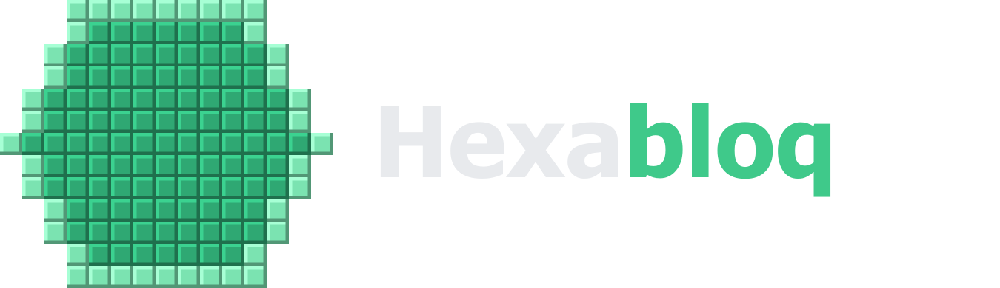

<p align="center"></p>

# Hexabloq

**Figuras con bloques, fila a fila.** Aplicación de escritorio para Windows para planificar construcciones de Minecraft sobre **chunks reales de 16 × 16**. Permite combinar **círculos, triángulos equiláteros y hexágonos regulares** hechos con bloques cuadrados: colocar varias figuras, agruparlas, fusionarlas en estructuras compuestas y obtener la guía de construcción por filas y por chunk. Cada celda de la cuadrícula es un bloque completo, sin suavizado ni bloques parciales.

- Programa con ventana propia (Python + PySide6). No usa navegador, servidor ni conexión a internet.
- La cuadrícula, el conteo, la guía, el PNG y el JSON salen **del mismo conjunto final de bloques**.

---

## Identidad visual

- **Nombre:** *Hexabloq* une «hexágono» y «bloque». Es corto, fácil de recordar y apunta a la figura principal de la aplicación.
- **Logo:** un hexágono escalonado con una **H calada** en el centro, construido sobre una retícula de 8 unidades. Un degradado de menta a esmeralda y pequeños acentos de bloques completan el símbolo. La marca es independiente de las plantillas geométricas de construcción.
- **Icono:** el mismo monograma sobre una placa oscura de esquinas redondeadas. De 16 a 48 px se simplifican los detalles y se ajustan los vértices a píxeles enteros; de 64 a 256 px se conserva el acabado completo. El archivo ICO contiene nueve resoluciones para Windows.
- **Paleta:**

  | Uso | Color |
  |---|---|
  | Fondos | `#121417` (base), `#1A1D21` (paneles), `#22262B` (superficies) |
  | Texto | `#E8EAED` (principal), `#A3ABB4` (secundario) |
  | Acento | verde esmeralda `#3FC98A` |
  | Fila resaltada | ámbar `#F5B83D` |
  | Errores | `#F07171` |

- **Tipografía:** Segoe UI, la fuente del sistema en Windows.

Los recursos están en [figuras_bloques/recursos/](figuras_bloques/recursos/):

- **`marca/`**:
  - `logo.svg` y `logo.png`: el símbolo con fondo transparente.
  - `logo_nombre.svg` y `logo_nombre.png`: el símbolo con el nombre y el lema, para fondos oscuros.
  - `logo_nombre_claro.svg` y `logo_nombre_claro.png`: versión para fondos claros.
  - `icono.svg`: el icono simplificado.
  - `icono.ico`: con 9 resoluciones, de 16 a 256 px.
  - `icono_256.png`.
  - `icono.png`: icono de 512 px.
  - `vista_previa.png`: lámina con las variantes y los tamaños del icono.
- **`iconos/`**: iconos de interfaz en SVG, de trazo uniforme, que la app colorea según el estado del botón.

Se regeneran con `python tools/generar_identidad.py`. Todos son originales y locales. Las letras de los logos SVG están convertidas en trazados: los archivos exportados no dependen de las fuentes instaladas. El generador usa Segoe UI al regenerarlos en Windows.

---

## Instalación y ejecución

### Opción A: ejecutable (no necesita Python)

Ejecuta `dist\Hexabloq.exe`. Es un único archivo que puedes copiar donde quieras; lleva incrustados el icono, el logo y la información de versión.

Para volver a generarlo, haz doble clic en **`construir_exe.bat`**. El script:

1. crea el entorno virtual `.venv` si no existe;
2. instala `requirements-dev.txt`;
3. ejecuta las pruebas y se detiene si alguna falla;
4. genera `dist\Hexabloq.exe` con PyInstaller, según `Hexabloq.spec`.

El `.spec` incluye la carpeta `figuras_bloques/recursos`, el icono `icono.ico` y los datos de versión de [empaquetado/version_info.txt](empaquetado/version_info.txt).

Para comprobar que un ejecutable carga todos sus recursos:

```bat
dist\Hexabloq.exe --comprobar-recursos estado.json
```

Escribe en `estado.json` si cada recurso se carga, y termina con código 0 si todo está bien.

### Opción B: desde el código fuente

Requisitos: Python 3.10 o superior.

```bat
py -3 -m venv .venv
.venv\Scripts\python -m pip install -r requirements.txt
.venv\Scripts\python main.py
```

También puedes hacer doble clic en `ejecutar.bat`, que hace lo mismo.

### Pruebas

```bat
.venv\Scripts\python -m pip install -r requirements-dev.txt
.venv\Scripts\python -m pytest
```

---

## Mundo, chunks y coordenadas

La cuadrícula representa el mundo **visto desde arriba**, como un mapa de Minecraft:

- **X** crece hacia el este (derecha) y **Z** hacia el sur (abajo). Cada celda es un bloque.
- Los **chunks** miden exactamente **16 × 16 bloques** y están anclados al mundo, no a las figuras. 16 × 16 es el tamaño de cada chunk, no el límite del lienzo: una construcción puede ocupar todos los chunks que haga falta.
- El chunk (0, 0) contiene los bloques X 0…15 y Z 0…15.
- Para las coordenadas negativas se usa la división hacia menos infinito. El bloque X = −1 pertenece al chunk −1 y su posición local es 15; el bloque X = 16 abre el chunk 1 con posición local 0. Es la misma regla que usa Minecraft, así que coincide con lo que muestra la pantalla F3.

En la cuadrícula:

| Elemento | Aspecto |
|---|---|
| Líneas entre bloques | finas y discretas; se ocultan al alejar la vista |
| Límites de chunk | más visibles; al alejar mucho se dibujan cada 2, 4… chunks para no saturar |
| Ejes del mundo | X = 0 en rojo, Z = 0 en azul, con un círculo en el origen (0, 0) |
| Coordenadas | reglas en los bordes con X y Z (los límites de chunk, en negrita) y la etiqueta de cada chunk cuando hay espacio |

Cada una de estas ayudas se activa por separado desde la barra de la cuadrícula. Ninguna cuenta como bloque.

Al pasar el cursor, la barra de estado muestra las coordenadas globales, el chunk y la posición local, por ejemplo `X -1 · Z 16 · chunk (-1, 1) · local (15, 0)`, y la figura que hay debajo.

---

## Uso

| Zona | Qué hace |
|---|---|
| **Barra superior** | Nuevo, Abrir, Guardar, Exportar (PNG, instrucciones o copiar), Deshacer y Rehacer. *Panel* muestra u oculta el panel derecho; **?** abre la ayuda, los atajos, *Guardar como* y la información de la app. |
| **Panel izquierdo (propiedades)** | Sin selección: la **plantilla** de la próxima figura (tipo, tamaño, orientación, modo y color) y *Añadir figura*. Con una figura: sus propiedades, su posición X y Z, el chunk de su esquina, la visibilidad y el bloqueo. Con varias: posición conjunta, color, modo, alineación, *Agrupar* y *Fusionar*. |
| **Cuadrícula** | Herramientas separadas: **Seleccionar** (V), **Mover vista** (H) y **Añadir** (A). Zoom con la rueda; mover la vista con el botón central o con Espacio + arrastrar. Interruptores de bloques, chunks, coordenadas, ejes, *Ajustar a chunks* y fondo claro. |
| **Panel derecho, pestaña Objetos** | Lista de figuras y grupos; arriba quedan las que están encima. Iconos para mostrar u ocultar y bloquear o desbloquear; doble clic para renombrar. Botones para duplicar, eliminar, agrupar, desagrupar, fusionar, separar, subir y bajar. |
| **Panel derecho, pestaña Construcción** | Bloques únicos, dimensiones, chunks ocupados, tabla de bloques por chunk y guía por filas, del diseño completo o de la selección. |
| **Barra de estado** | Coordenadas bajo el cursor, resumen del diseño y de la selección, zoom y avisos breves. |

### Crear y colocar figuras

- **Añadir:** *Añadir figura* (o Insert) coloca la plantilla en el centro de la vista. Con la herramienta *Añadir*, una vista previa sigue al cursor y cada clic coloca una figura nueva. Las figuras existentes nunca se reemplazan.
- **Seleccionar:** clic sobre una figura (dentro de su área, aunque sea de contorno). Mayús suma a la selección, Ctrl alterna, y arrastrar en una zona vacía dibuja una banda de selección. También se puede seleccionar desde la lista de objetos.
- **Mover:**
  - Arrastrando con la herramienta *Seleccionar*, siempre a bloques enteros.
  - Con las flechas: 1 bloque. Con Mayús + flechas: 16 bloques (un chunk).
  - Escribiendo X y Z en el panel de propiedades.
  - Con *Ajustar a chunks* activo, la esquina norte-oeste de la selección cae en la esquina de chunk más cercana.
- **Alinear:** con varias figuras seleccionadas, alinea bordes (oeste, este, norte, sur) o centros con la caja de toda la selección.
- **Bloquear y ocultar:**
  - Una figura **bloqueada** no se mueve, no se edita y no se elimina, pero sigue contando en la construcción.
  - Una figura **oculta** no cuenta ni se exporta.
- **Selección visible:** la selección se marca con un recuadro discontinuo cian, con tiradores en las esquinas y el centro de la figura. Los grupos se marcan con un recuadro punteado. Nada de esto son bloques y no aparece en las exportaciones.
- **Deshacer y rehacer** (Ctrl+Z / Ctrl+Y) cubren añadir, mover, editar, duplicar, eliminar, agrupar, fusionar, separar, ocultar, bloquear, renombrar y reordenar. Varios cambios seguidos sobre el mismo campo, o varias pulsaciones de flecha seguidas, se deshacen de una vez.

### Agrupar y fusionar

Son dos acciones distintas:

- **Agrupar** (Ctrl+G) mantiene las figuras independientes, pero se seleccionan y se mueven juntas desde la cuadrícula. Desagrupar (Ctrl+Shift+G) las libera y conserva sus posiciones. En la lista de objetos se puede elegir un solo miembro para editarlo.
- **Fusionar** (Ctrl+M) sustituye las figuras seleccionadas por una **figura compuesta**. Hay dos modos:
  - **Conservar los bloques:** unión exacta de los bloques que ocupan ahora las figuras, tal como se ven, contornos internos incluidos.
  - **Crear silueta conjunta:** une las **áreas rellenas** de las figuras originales y genera el resultado en **relleno** o en **contorno**.
    - En contorno solo queda el borde de la unión: desaparecen las líneas internas donde las figuras se solapan.
    - **Huecos interiores:** si la unión encierra zonas vacías (por ejemplo, un anillo de hexágonos), esas zonas **siguen vacías**, tanto en contorno como en relleno, y **su borde forma parte del contorno**.

En ambos modos:

- **Figuras separadas:** no se inventan bloques ni puentes para unirlas; la compuesta las mantiene separadas.
- **Bloques compartidos:** ocupan una sola posición y cuentan una sola vez.
- **Origen editable:** la figura compuesta guarda sus figuras de origen.
  - En sus propiedades se puede cambiar entre bloques conservados y silueta, y entre contorno y relleno.
  - *Separar* (Ctrl+Shift+M) devuelve las figuras originales a su posición actual, aunque la compuesta se haya movido.
- **Anidamiento:** se pueden fusionar figuras que ya son compuestas.

### Conteo y guía de construcción

Todo sale de un único conjunto final de bloques, que se calcula combinando las figuras visibles en orden de apilado. La cuadrícula, los contadores, la guía, el JSON y las exportaciones leen ese mismo conjunto.

- **Bloques únicos:** cada posición cuenta una vez, aunque la ocupen varias figuras.
- **Color de los bloques compartidos:** es el de la figura que está **más arriba en la lista de objetos** (la última en el orden de apilado). Esta regla se aplica igual en pantalla y al exportar. Para cambiarlo, usa *Subir*, *Bajar*, *Traer al frente* o *Enviar al fondo*.
- **Chunks ocupados:** tabla con cada chunk, su rango de X y Z y los bloques que necesita. Al hacer clic en un chunk, la vista lo encuadra y la guía muestra solo sus filas.
- **Guía por filas:** cada fila Z con sus tramos de X en coordenadas globales (por ejemplo, `Z -3: X -9–-7 | 12–30`). Clic en una fila para resaltarla en la cuadrícula; Alt+↑ / Alt+↓ cambia de fila.
- **Ámbito:** el selector *Calcular para* alterna entre el diseño completo y la selección.

### Guardar, abrir y exportar

- **Guardar** (Ctrl+S) crea un JSON versión 2 con:
  - todas las figuras, con identificador, nombre, tipo, tamaño, orientación, modo, color, posición, visibilidad, bloqueo y grupo;
  - el orden de apilado y los grupos;
  - las figuras compuestas con sus figuras de origen;
  - el resultado: total, límites, bloques por chunk y la lista `[x, z, color]` de todos los bloques.
- **Abrir** (Ctrl+O) recalcula el diseño y avisa si los bloques guardados no coinciden. Los **diseños anteriores de una sola figura** (versión 1) se abren como un documento con un objeto en X = 0, Z = 0.
- **Exportar PNG** (Ctrl+E): el diseño completo o la selección, con cuadrícula, límites de chunks y coordenadas opcionales, y fondo claro, oscuro o transparente. La imagen siempre cubre todo el contenido elegido, sin importar el zoom ni el desplazamiento de la vista, y nunca incluye la selección, el cursor ni los ejes.
- **Instrucciones** (Ctrl+Shift+E para exportar, Ctrl+Shift+C para copiar), de todo el diseño o de la selección:
  - **completas**, fila a fila;
  - **por chunk**, con cada chunk y sus filas en coordenadas globales y locales (0–15), para construir chunk a chunk.

Antes de cerrar, abrir otro diseño o empezar uno nuevo, la app pregunta si quieres guardar los cambios. Se guardan localmente las preferencias de vista, la plantilla, el tamaño de la ventana y el de los paneles.

### Atajos de teclado

| Teclas | Acción |
|---|---|
| Ctrl+N / Ctrl+O / Ctrl+S / Ctrl+Shift+S | Nuevo / abrir / guardar / guardar como |
| Ctrl+E · Ctrl+Shift+E · Ctrl+Shift+C | Exportar PNG · exportar instrucciones · copiar instrucciones |
| Ctrl+Z · Ctrl+Y | Deshacer · rehacer |
| Insert | Añadir la plantilla en el centro de la vista |
| Ctrl+A · Esc | Seleccionar todo · quitar selección (o volver a la herramienta Seleccionar) |
| Ctrl+D · Supr | Duplicar · eliminar |
| Ctrl+G · Ctrl+Shift+G | Agrupar · desagrupar |
| Ctrl+M · Ctrl+Shift+M | Fusionar · separar |
| Ctrl+] · Ctrl+[ · Ctrl+Shift+] · Ctrl+Shift+[ | Subir · bajar · al frente · al fondo |
| Flechas · Mayús+flechas | Mover la selección 1 bloque · 16 bloques |
| V / H / A | Herramienta Seleccionar / Mover vista / Añadir |
| G / K / N / X / S / B | Bloques / chunks / coordenadas / ejes / ajustar a chunks / fondo claro |
| F · C · Ctrl+0 | Encuadrar el diseño · centrar en la selección u origen · encuadrar |
| Ctrl+1 / 2 / 3 · Ctrl+L · Ctrl+T | Tipo de figura · ir al tamaño · contorno o relleno |
| Alt+↑ / Alt+↓ | Fila anterior o siguiente de la guía |
| Ctrl+B · F1 · Ctrl+/ | Panel derecho · ayuda · lista de atajos |

Las teclas de una sola letra funcionan cuando el foco está en la cuadrícula o en su barra, para no interferir al escribir en los campos.

---

## Cómo se interpretan las medidas

| Figura | Tamaño que introduces | Medida que se calcula |
|---|---|---|
| Círculo | **Diámetro** = ancho = alto | — |
| Triángulo equilátero | **Ancho de la base** (con el vértice a izquierda o derecha, la base es vertical) | Altura = base × √3/2 |
| Hexágono, **lado plano arriba** | **Ancho total de vértice a vértice** (= 2 × lado) | Alto = ancho × √3/2 ≈ 0,866 × ancho; lado = ancho/2 |
| Hexágono, **vértice arriba** | **Ancho total de lado plano a lado plano** | Alto = ancho × 2/√3 ≈ 1,155 × ancho; lado = ancho/√3 |

- **El ancho en bloques es siempre exactamente el que pides.** La otra dimensión se calcula con la proporción geométrica de la figura y después se convierte a bloques. La app muestra los dos valores; por ejemplo, «Alto calculado: 8,66 → 9 bloques».
- **Centro con tamaños impares:** hay una columna central (y una fila central, si el alto también es impar).
- **Centro con tamaños pares:** el centro cae sobre la línea entre dos columnas (o filas). La guía lo indica, por ejemplo: «fila 5, entre las columnas 5 y 6».
- En el triángulo, el «centro» es el centroide, a un tercio de la altura medido desde la base.

---

## Algoritmo geométrico

El código está en [figuras_bloques/geometria.py](figuras_bloques/geometria.py) y no depende de la interfaz.

1. **Figura continua exacta.** Se construye la figura regular ideal con el ancho pedido. El hexágono tiene sus seis lados iguales y ángulos de 120°; el triángulo es equilátero.

2. **Colocación sobre la cuadrícula.** La figura ocupa exactamente `[0, ancho]` en horizontal y queda centrada. En vertical caben dos colocaciones:
   - con el centro en una fila (alto impar);
   - con el centro en la línea entre dos filas (alto par).

   Se generan las dos y **se elige la que da un alto en bloques más cercano al teórico**; si empatan, la impar. En el triángulo se prueba la base apoyada en una línea de la cuadrícula o pasando por los centros de la última fila.

3. **Criterio de pertenencia: muestreo por centro.** Un bloque forma parte de la figura **si el centro de su celda está dentro de la figura o sobre su borde**. Para el borde se usa una tolerancia fija de 10⁻⁹, así que el resultado es determinista. Como las tres figuras son convexas, cada fila es un único tramo `[x0, x1]` que se calcula de forma analítica. La figura más grande, de 1000 bloques, se genera en milisegundos.

4. **Contorno.** Son los bloques del relleno que tienen al menos un vecino **ortogonal** (arriba, abajo, izquierda o derecha) fuera de la figura. Esto da un borde de un bloque de grosor que, en los escalones, se une en diagonal (como en las construcciones típicas) y que encierra el interior por completo.

5. **Simetrías.** El hexágono y el círculo se calculan a partir de la distancia al centro, así que salen exactamente simétricos de izquierda a derecha y de arriba abajo; el círculo, además, por la diagonal. Las orientaciones del triángulo son reflejos o la transpuesta de la misma figura.

### Por qué son aproximaciones

Un hexágono o un círculo regulares no se pueden formar exactamente con cuadrados. Sus bordes inclinados tienen pendientes irracionales: √3 en el hexágono, curva en el círculo. La cuadrícula solo conserva las simetrías de espejo horizontal y vertical, no los giros de 60°. Lo que da la app es **la mejor aproximación con bloques completos según un criterio único y consistente**:

- Los lados inclinados del hexágono con lado plano arriba avanzan 0 o 1 bloque por fila (pendiente real ≈ 0,58).
- Los del hexágono con vértice arriba avanzan 1 o 2 bloques por fila (pendiente real ≈ 1,73), y siguen la recta exacta con menos de un bloque de error.
- El alto real se aleja del teórico como máximo **0,5 bloques** en el hexágono con lado plano arriba y **0,58** en el de vértice arriba, para todos los anchos de 1 a 1000.
- En los vértices agudos del triángulo (60°), la diferencia puede llegar a 0,87 bloques.
- En tamaños muy pequeños (menos de unos 6 bloques), las figuras se parecen inevitablemente a cuadrados o rombos.

---

## Estructura del proyecto

```
main.py                         Punto de entrada
figuras_bloques/
  geometria.py                  Algoritmos de cada figura (sin Qt): Configuracion → Figura
  intervalos.py                 Operaciones de filas de bloques como intervalos (unión, resta, contorno)
  chunks.py                     Chunks de 16 × 16 anclados al mundo
  documento.py                  Modelo: objetos, grupos, figuras compuestas y su forma
  operaciones.py                Edición pura del documento: añadir, mover, fusionar, alinear…
  historial.py                  Deshacer y rehacer con instantáneas inmutables
  construccion.py               Conjunto final de bloques, conteo por chunk e instrucciones
  archivo.py                    JSON versión 2 (y lectura de la versión 1)
  guia.py                       Utilidades de texto y guía de una sola figura
  app.py                        Arranque, icono en la barra de tareas y --comprobar-recursos
  recursos/                     Logo, icono e iconos de interfaz
  ui/ventana.py                 Coordinación: documento, historial, selección, archivos y preferencias
  ui/lienzo.py                  Cuadrícula interactiva: herramientas, selección y arrastre
  ui/render.py                  Dibujo del mundo (compartido con el PNG) y ayudas de edición
  ui/panel_propiedades.py       Plantilla y propiedades de la selección
  ui/panel_objetos.py           Lista de objetos y grupos
  ui/panel_construccion.py      Conteo, chunks y guía por filas
  ui/exportar.py                PNG e instrucciones, independientes de la vista
  ui/dialogos.py                Ayuda, atajos, fusión y confirmaciones
  ui/barra.py · tema.py · recursos.py   Barra adaptable, estilo y carga de recursos
tests/                          Pruebas (pytest) y diseños de la versión 1 para compatibilidad
tools/generar_identidad.py      Regenera logo, icono e ICO
empaquetado/version_info.txt    Datos de versión del ejecutable
Hexabloq.spec                   Configuración de PyInstaller
construir_exe.bat · ejecutar.bat
```

El modelo (`documento`, `operaciones`, `historial`), las operaciones geométricas (`geometria`, `intervalos`, `chunks`, `construccion`) y la representación (`ui/`) están separados. Ninguno de los módulos del modelo ni de la geometría depende de Qt.

## Qué comprueban las pruebas

- **Figuras:**
  - Hexágonos de todos los tamaños de 1 a 80 y de 99 a 1000, en ambas orientaciones y modos: ancho exacto, alto teórico, simetrías, convexidad, pendiente de los bordes, y contorno continuo y sin grosores de 2×2.
  - Círculos y triángulos: dimensiones, simetrías y orientaciones equivalentes.
- **Chunks:**
  - Límites en 15/16, −1/0, −16/−17 y −32/−33.
  - Reparto de tramos sin pérdidas y figuras que atraviesan decenas de chunks.
- **Construcción:**
  - Solapamientos sin doble conteo.
  - Color de la figura superior en los bloques compartidos.
  - Figuras ocultas excluidas y bloqueadas incluidas.
  - La guía y las instrucciones por chunk coinciden con los bloques.
- **Fusión:**
  - La silueta conjunta no tiene líneas internas y es la unión de las áreas.
  - Los huecos se conservan vacíos con su borde.
  - Las figuras separadas no se conectan.
  - La fusión de bloques conserva las celdas.
  - La fusión anidada funciona.
  - Separar restaura los orígenes movidos.
- **Operaciones:**
  - Identificadores únicos.
  - Grupos que se mueven conservando las posiciones relativas.
  - Bloqueo, duplicado de grupos, alineación, orden y ajuste a chunks.
- **Historial:** deshacer y rehacer todas las operaciones, y unión de ediciones consecutivas.
- **Archivos:**
  - Guardado y reapertura de diseños compuestos, con grupos, ocultos y bloqueados.
  - Apertura de diseños reales guardados con la versión anterior.
  - Avisos ante bloques alterados y errores claros ante archivos mal formados.
- **Interfaz** (sin mostrar ventanas):
  - Añadir sin reemplazar.
  - Selección desde el lienzo y desde el panel.
  - Arrastre con vista previa y deshacer.
  - Flechas con y sin Mayús, y ajuste a chunks.
  - Agrupar, fusionar y separar.
  - Edición y validación de propiedades, y parámetros visibles según la figura.
  - Panel de construcción por ámbito.
  - El PNG contiene exactamente los bloques y colores, con cualquier fondo.
  - Cambios sin guardar y preferencias.
  - Atajos.
  - Recursos cargados desde otro directorio.
